# Wellness Membership Platform

> A modern, subscription-based wellness membership SaaS — video library, live classes, community, commerce, events, and lifecycle automation, unified into a single member-owned experience.

<p align="left">
  
  
  
  
  
  
  
  
  
</p>

<p align="left">
  
  
  
  
  
  
  
  
</p>

The **Wellness Membership Platform** is a full-stack, production-grade SaaS designed for modern wellness brands, boutique studios, and lifestyle communities that need more than a scheduling tool or a video hosting page. It unifies a **protected video library**, a **live community**, **tiered memberships**, a **curated shop with affiliate tracking**, **event RSVPs**, **content publishing**, and a **lifecycle automation engine** into one cohesive product — served from the edge and owned end-to-end by the brand.

This repository is the reference implementation deployed as **B.MARC Pilates** — a wellness ecosystem framed as "more than a studio." The codebase, patterns, and architecture, however, are intentionally generic: every feature is config-driven, white-labelable, and reusable for any subscription wellness or lifestyle brand.

---

## Table of Contents

1. [Project Overview](#project-overview)
2. [The Business Problem](#the-business-problem)
3. [The Solution](#the-solution)
4. [Target Audience](#target-audience)
5. [Product Goals](#product-goals)
6. [Core Features](#core-features)
7. [Community Experience](#community-experience)
8. [Membership Journey](#membership-journey)
9. [Platform Ecosystem](#platform-ecosystem)
10. [Technical Architecture](#technical-architecture)
11. [Technology Stack](#technology-stack)
12. [System Architecture Diagrams](#system-architecture-diagrams)
13. [User Journey Diagram](#user-journey-diagram)
14. [Community Architecture Diagram](#community-architecture-diagram)
15. [Platform Ecosystem Diagram](#platform-ecosystem-diagram)
16. [Folder Structure](#folder-structure)
17. [Accessibility](#accessibility)
18. [Performance](#performance)
19. [Security](#security)
20. [Scalability](#scalability)
21. [Future Roadmap](#future-roadmap)
22. [Screenshots](#screenshots)
23. [Getting Started](#getting-started)
24. [Lessons Learned](#lessons-learned)
25. [Conclusion](#conclusion)
26. [License and Credits](#license-and-credits)

---

## Project Overview

### Purpose

The Wellness Membership Platform exists to give wellness brands a **single, member-owned home** for everything they offer — movement, education, community, commerce, and events — without stitching together six SaaS tools that don't talk to each other.

A modern wellness brand today is expected to be:

- A **content publisher** (video classes, articles, guides, newsletters).
- A **community host** (channels, discussions, challenges, accountability).
- A **subscription business** (tiered memberships with recurring revenue).
- A **retailer** (physical picks, digital products, affiliate curation).
- An **event producer** (pop-ups, workshops, retreats, live classes).
- A **lifecycle marketer** (email, SMS, onboarding journeys, win-back).

Most brands solve this with a Frankenstein of Kajabi + Circle + Shopify + Mailchimp + Calendly + Squarespace + Linktree. The result is a broken member experience, five logins, no shared identity, and no single source of truth for engagement.

This platform collapses that stack. One login. One profile. One membership record. One dashboard. One brand.

### Vision

Build the operating system for the **next generation of wellness businesses** — where the studio, the app, the shop, the newsletter, and the community are not separate products but different rooms in the same house.

The long-term thesis is that wellness brands will look more like **media companies with recurring revenue** and less like brick-and-mortar studios. The platform is designed around that trajectory: content-first, community-native, subscription-anchored, commerce-enabled.

### Customer Experience

From the visitor's perspective, the journey is intentionally frictionless:

1. **Discover** the brand on Instagram, Google, or through a friend.
2. **Land** on a visually distinctive homepage that communicates identity in under three seconds.
3. **Explore** free content — public classes, event pages, the shop, the about story.
4. **Join** the community for free during the founding phase (email + optional SMS opt-in).
5. **Get onboarded** through a lifecycle journey — welcome email, community tour, first-class invitation.
6. **Engage** with content, events, and other members.
7. **Upgrade** into a paid membership tier when the value is undeniable.
8. **Stay** because the community, the routine, and the identity are now part of daily life.

### Ecosystem Framing

The platform is not "an app." It is an **ecosystem** with seven interlocking surfaces:

| Surface | What it is | Who it's for |
|---|---|---|
| **Public Site** | Marketing, brand, SEO-optimized pages | Visitors, prospects |
| **Shop** | Curated products, affiliate links, digital downloads | Everyone |
| **Events** | Pop-ups, workshops, RSVPs, waitlists | Leads and members |
| **Member Portal** | Dashboard, profile, events, protected content | Signed-in members |
| **Video Library** | Public channel + members-only sessions | Members by tier |
| **Community** | Channels, discussions, challenges | Members |
| **Admin Studio** | Content, journeys, users, roles, analytics | Operators, admins |

Each surface shares the same identity, the same data, and the same visual language — because they are all the same codebase.

---

## The Business Problem

Modern wellness businesses share a set of painful structural problems that no single off-the-shelf tool solves cleanly.

### 1. Fragmentation

The average wellness brand runs on **six to nine disconnected SaaS tools**: Squarespace for the site, Mindbody or Acuity for scheduling, Kajabi or Teachable for courses, Circle or Discord for community, Shopify for products, Mailchimp or Flodesk for email, Klaviyo or SimpleTexting for SMS, Linktree for the bio link, and a Notion-Google Sheets tangle in the back office.

Each tool has its own login, its own member record, its own analytics, its own billing, and — crucially — its own idea of who the customer is. The result: no member has a single identity across the brand, and the brand has no single view of the member.

### 2. Retention Is Flat

Wellness subscription products (fitness apps, class packs, community memberships) hover around a **60–70% 12-month churn rate**. The industry knows the fix — community, accountability, ritual, identity — but the tools don't support it. A class pack that lives in Mindbody doesn't know that the member has been quiet in the community for three weeks. An email platform doesn't know that a member watched four sessions this week and deserves a check-in from the founder.

Retention requires a **unified engagement graph**. That is exactly what the platform provides.

### 3. Accountability Deficit

Members join wellness products with intent and drop off with silence. The difference between a member who churns in month two and a member who renews for the third year is almost always **community accountability** — a challenge, a check-in, a small group, a coach, a peer.

Most tools treat community as a bolt-on. This platform treats it as **first-class primary infrastructure**, sitting alongside content and commerce.

### 4. Tool Sprawl and Operator Burnout

Every new tool is a new subscription, a new integration, a new place things can break, and a new onboarding burden for staff. Small wellness brands — the exact segment growing fastest — cannot afford a full-time ops person to babysit seven SaaS logins.

Consolidating the stack is not a nice-to-have; it is a **survival requirement** for lean, founder-led wellness brands.

### 5. Data Ownership

When a brand's members live inside Circle, Kajabi, and Shopify, the brand **does not own its data**. Export tools are limited. Cross-tool analytics are impossible. If a platform changes pricing, the brand is captive.

This platform is built so the brand **owns its Postgres database**, its user records, its content, its analytics, and its ability to migrate — because it runs on open, portable infrastructure (Supabase Postgres, Cloudflare Workers, standard open-source frameworks).

### 6. Content Without Distribution

Wellness founders create endless content — reels, classes, guides, newsletters — but the content lives on rented platforms (Instagram, YouTube, Substack) with no direct path into a durable customer relationship. A viral reel produces followers, not members.

The platform is designed to be the **destination** at the end of every social funnel, converting attention into identity.

---

## The Solution

The Wellness Membership Platform provides ten integrated capability areas, each addressing a specific business problem.

### 1. Protected Video Library

A dual-mode video experience: a **public channel** for discovery and SEO, and a **members-only library** gated by membership tier. Both are curated by admins in the same studio, published to different audiences by policy.

### 2. Community

Named channels (Movement, Nutrition, Recovery, Mindset, Wins, Introductions, etc.) with threaded discussions, reactions, and moderation tools. Members build identity and accountability inside the brand instead of on rented platforms.

### 3. Tiered Memberships

Three-tier structure out of the box — **Community Access**, **Signature Access**, **All Access** — with policy-driven entitlements. Founding-phase pricing (complimentary) transitions cleanly to paid tiers via Stripe when the brand is ready.

### 4. Nutrition Guidance

Structured nutrition content — recipes, meal frameworks, hydration guides — attached to the same content publishing pipeline as video, with tier gating.

### 5. Recovery Content

Mobility routines, stretch flows, breathwork, sleep hygiene — recognized as first-class content categories, not afterthoughts.

### 6. Self-Care Rituals

Guided rituals (morning practice, wind-down, cycle-syncing) delivered as multi-day journeys with email + in-app touchpoints.

### 7. Challenges

Time-boxed programs (7-day, 21-day, 30-day) with cohort dynamics, daily prompts, community check-ins, and completion recognition. Challenges are the single most powerful retention lever in the platform.

### 8. Events

Pop-up classes, workshops, retreats, and studio openings — with RSVPs, waitlists, capacity limits, and post-event follow-up automation.

### 9. Digital Resources

Downloadable guides, PDFs, workbooks, printable plans — sold or gifted through the shop, gated by ownership or tier.

### 10. Commerce and Curation

A curated shop of physical picks, tools, essentials, and digital products. Affiliate links are tracked via short-link infrastructure with click attribution. Digital products deliver immediately post-purchase.

---

## Target Audience

Seven personas ground every product decision.

### 1. The Aspirational Beginner — "Ava"

Age 24–32. Discovered Pilates on Instagram. Intimidated by boutique studios. Wants to try before committing. Needs beginner-friendly content, community welcome, and no-judgment on-ramps.

**Platform value:** Free founding-tier access, beginner channel, guided first-week journey.

### 2. The Committed Practitioner — "Maya"

Age 28–42. Already trains 3–5x weekly. Wants variety, depth, and access to the founder's expertise. Willing to pay for premium content and small-group experiences.

**Platform value:** Signature tier, advanced classes, early event access, private channels.

### 3. The Wellness Curator — "Sasha"

Age 30–45. Treats wellness as identity. Buys the mat, the socks, the supplements, the aesthetic. High LTV, high referral potential.

**Platform value:** All Access tier, curated shop, gift bags at events, VIP invitations.

### 4. The Community Seeker — "Jordan"

Age 22–35. New to a city or life stage. Looking for a wellness peer group, not just workouts. Values discussion, accountability, and shared rituals.

**Platform value:** Community channels, challenges, IRL pop-ups, member introductions.

### 5. The Time-Constrained Professional — "Priya"

Age 30–48. High-performing career. 20 minutes to train, no time to research. Wants a trusted source that tells her exactly what to do today.

**Platform value:** Curated daily plans, short-format content, mobile-first portal, calendar sync.

### 6. The Post-Studio Alumna — "Renée"

Age 28–50. Loved a studio, moved cities, misses the ritual and the people. Needs a way to keep the practice alive at a distance.

**Platform value:** Digital reformer sessions, live-streamed classes, community continuity.

### 7. The Founder-Operator — "The Brand"

The wellness brand owner using this platform. Age 28–45. Wears every hat. Needs one tool that handles content, community, commerce, and communication without a full-time engineer.

**Platform value:** Admin studio, journeys, RBAC, config-driven branding, edge hosting.

---

## Product Goals

Measurable objectives that shape every roadmap decision.

| Goal | Target | Rationale |
|---|---|---|
| **7-day activation** | ≥ 60% of new members complete first session or first community post within 7 days | Predictor of long-term retention |
| **30-day retention** | ≥ 75% of paid members active at day 30 | Baseline health metric |
| **12-month retention** | ≥ 45% of paid members renew after 12 months | 2× the industry average |
| **Community DAU/MAU** | ≥ 25% daily-to-monthly active ratio | Indicates community stickiness |
| **Content publish cadence** | ≥ 3 new pieces per week | Fresh content is a retention driver |
| **Event attendance rate** | ≥ 70% of RSVPs show up | Signals real intent |
| **Member LTV** | ≥ 6× CAC within 18 months | Sustainable growth math |
| **NPS** | ≥ 55 among 90-day members | Above-average for wellness SaaS |
| **Shop attach rate** | ≥ 20% of members purchase at least one product per year | Diversified revenue |
| **Support tickets per member per month** | ≤ 0.1 | Product should self-serve |
| **P95 page load (edge)** | ≤ 800 ms globally | Edge SSR baseline |
| **Uptime** | ≥ 99.9% | Table stakes for paid subscriptions |

---

## Core Features

Nineteen feature areas, each documented as **What / Why / Business Value**.

### 1. Membership Tiers and Access Control

**What.** Three-tier membership structure (Community, Signature, All Access) with per-tier entitlements enforced at the database level through Row-Level Security and at the application level through role-based access checks.

**Why.** Tiering is the mechanism by which the platform converts free community members into paid subscribers, and paid subscribers into premium subscribers. It creates a legible upgrade path.

**Business Value.** Recurring revenue with clear price anchoring. During the founding phase, all tiers are complimentary; when the brand introduces pricing, existing members convert on their earned tier without a re-signup flow.

### 2. Protected Video Library

**What.** A video experience with two audiences: **Public Channel** (free, indexable, discoverable) and **Members Library** (gated by tier). Both share the same content pipeline, publishing UI, and metadata schema. The tier gate is enforced server-side.

**Why.** Content is the primary product. A public channel drives discovery and SEO; the members-only library drives conversion and retention.

**Business Value.** Content compounds. Every published session is a permanent lead magnet, a permanent member benefit, and a permanent search asset.

### 3. Live Classes and Scheduling

**What.** Live-streamed and in-person class scheduling with RSVPs, capacity limits, waitlists, and calendar integration.

**Why.** Live sessions are the single strongest driver of community identity and habit formation. Members show up for a *time*, not just a video.

**Business Value.** Habit formation is retention. Members who attend one live session per week churn at less than half the rate of on-demand-only members.

### 4. Community Channels

**What.** Named channels with threaded discussions, reactions, mentions, and moderation. Each channel has a purpose (Movement, Nutrition, Mindset, Wins, etc.) and its own membership.

**Why.** Members join for content but stay for people. Channels give the community structure and intent.

**Business Value.** Community-active members have 3–5× the retention of content-only members.

### 5. Challenges

**What.** Time-boxed programs (7, 21, 30 days) with daily prompts, cohort progress, and completion recognition. Each challenge has a landing page, a community channel, and an automated journey.

**Why.** Challenges combine content, community, and accountability into a single ritual.

**Business Value.** The single most powerful retention and reactivation lever. A well-run challenge converts dormant members and creates new upgrade moments.

### 6. Nutrition Content

**What.** Recipes, meal frameworks, hydration guides, cycle-aware nutrition — published through the same content studio, with the same tier gating.

**Why.** Nutrition is inseparable from movement in the wellness member's mind.

**Business Value.** Expands "reasons to visit" beyond workouts, deepens perceived value per subscription dollar.

### 7. Recovery Content

**What.** Mobility, stretch, breathwork, sleep, and cool-down content categorized as its own vertical.

**Why.** Recovery is the fastest-growing sub-category in wellness content and the most under-served by generic fitness apps.

**Business Value.** Differentiation vs. generic workout apps; attracts an older, higher-LTV audience.

### 8. Self-Care Rituals

**What.** Guided multi-day rituals (morning practice, wind-down, cycle syncing) delivered as journeys — a mix of content, email prompts, and community check-ins.

**Why.** Rituals turn content consumption into identity practice.

**Business Value.** Members who complete a ritual convert to higher tiers at meaningfully higher rates.

### 9. Events (Pop-Ups, Workshops, Retreats)

**What.** Event pages with RSVPs, waitlists, capacity limits, tier-gated early access, and post-event follow-up. Founding members get priority.

**Why.** IRL experiences convert digital members into brand evangelists.

**Business Value.** Highest referral-generating touchpoint in the platform.

### 10. Digital Products and Downloads

**What.** Downloadable PDFs, workbooks, guides, plans — either sold à la carte or included with a membership tier.

**Why.** Digital products are pure-margin revenue and low-friction upsells.

**Business Value.** Diversifies revenue beyond subscriptions.

### 11. Curated Shop with Affiliate Tracking

**What.** A shop of curated physical products and digital resources. Affiliate outbound links are routed through internal short links (`/go/$slug`) that track clicks before redirecting.

**Why.** The founder's taste is a product. Curation drives purchases the way influencer content does — but with attribution.

**Business Value.** Diversified revenue (affiliate commissions), better attribution than raw external links, and a data asset for future recommendations.

### 12. Content Studio

**What.** An admin interface for creating, editing, tagging, and publishing content (video, article, download, ritual, challenge). Content links directly into journeys via a resolved-email view.

**Why.** The brand publishes 3+ pieces per week; publishing must feel like Notion, not like Rails-scaffold CRUD.

**Business Value.** Publishing velocity is a retention input. Faster publishing = more surface area for engagement.

### 13. Journeys and Lifecycle Automation

**What.** Multi-step lifecycle journeys — welcome sequences, upgrade prompts, event follow-ups, dormant win-backs — assembled from triggers, delays, conditions, and content steps. Journeys reference published content directly.

**Why.** Every wellness brand needs onboarding, upgrade nudges, and reactivation. Nobody wants to hand-write these emails.

**Business Value.** Converts one-time setup into perpetual conversion and retention gains.

### 14. Email and SMS Delivery (Resend + Twilio-ready)

**What.** Transactional and lifecycle email delivery via Resend, with optional SMS delivery via Twilio. Both are configured, both are opt-in during signup.

**Why.** Members join through email and SMS opt-in gates; the platform must be able to reach them.

**Business Value.** Multi-channel lifecycle communication doubles activation rates over email alone.

### 15. Member Portal

**What.** A signed-in dashboard with account type, community status, quick actions (edit profile, view events, member content), and personalized recommendations.

**Why.** The portal is the member's "home." It must feel personal and calm, not busy.

**Business Value.** A used portal is a used product. Portal DAU is a leading indicator of retention.

### 16. Admin Studio

**What.** A protected admin interface for content, journeys, users, roles, events, shop items, and analytics. Split into focused surfaces (Content, Journeys, Users, Shop) with consistent patterns.

**Why.** Operators live in this UI daily; friction here is a per-day tax on the entire business.

**Business Value.** Fewer support tickets from staff, faster publishing, less risk of manual errors.

### 17. Role-Based Access Control (RBAC)

**What.** A dedicated `user_roles` table with an `app_role` enum (`admin`, `moderator`, `user`) and a `has_role(_user_id, _role)` security-definer function used inside RLS policies.

**Why.** Storing roles on the profile table is a well-known privilege-escalation footgun. Separating roles into a dedicated table with a security-definer check is the safe pattern.

**Business Value.** Enterprise-grade access control from day one; ready for future team roles (coach, editor, moderator, finance).

### 18. Analytics and Instrumentation

**What.** Structured event capture for content views, community activity, event RSVPs, shop clicks, and lifecycle progression. Analytics live in the same Postgres database as everything else.

**Why.** Retention experiments require honest, first-party data. Third-party analytics don't join to member records.

**Business Value.** The brand can answer "which content converts?" and "which channel retains?" without exporting anything.

### 19. Configurable White-Label Branding

**What.** All brand-specific values (name, logo, colors, integrations, tier names) live in `src/config/branding.ts` and `src/config/integrations.ts`. A new brand is a config change, not a fork.

**Why.** The platform is designed to run more than one brand.

**Business Value.** Multi-tenant potential; agency or platform-as-a-service business model unlocked.

---

## Community Experience

The community is not one big room. It is a curated set of channels, each with a clear purpose. The reference implementation ships with twelve.

| Channel | Purpose |
|---|---|
| **Introductions** | New members share who they are, why they're here, and what they're working on. First post is prompted by the welcome journey. |
| **Movement** | Pilates, mobility, strength — the core practice conversation. Class debriefs, form questions, favorites. |
| **Nutrition** | Recipes, meal ideas, hydration, cycle-syncing. Recipe-of-the-week rituals live here. |
| **Recovery** | Sleep, stretch, breathwork, cold plunge, sauna. Slower-tempo channel. |
| **Mindset** | Books, journaling prompts, therapy talk, intention-setting. |
| **Wins** | Small victories: first full class, stuck-with-it-for-30-days, pants fit again. High reaction density. |
| **Challenges** | Active challenge cohorts check in daily. Ephemeral by nature, archived on completion. |
| **Events** | Pop-up debriefs, upcoming event chatter, ride-shares, meet-at-the-door coordination. |
| **Ask the Founder** | Founder-answered questions. Async office hours. |
| **Local** | City-based sub-threads for IRL meetups (LA, NYC, Chicago, London). |
| **Beginners** | Judgment-free zone. Beginner questions get pinned, not buried. |
| **Curator** | Product finds, shop discussion, affiliate transparency. |

Every channel has: purpose, moderator, posting norms, a pinned welcome, and (where relevant) a linked journey and challenge.

---

## Membership Journey

The lifecycle from stranger to loyalist, narrated stage by stage.

### Stage 1 — Visitor

The visitor arrives from Instagram, a Google search, a friend, or a QR code at a pop-up. The public site loads in under a second at the edge, presents the brand's identity in the hero, and offers three doors: **Shop**, **Events**, **Join the Community**.

There is no dark pattern here. The visitor is allowed to leave. The site is optimized to be *memorable*, not sticky.

### Stage 2 — Lead

The visitor opens the "Join the Community" modal. Fields: first name, last name, email, phone (required for SMS opt-in), city, Instagram handle, interests (Pilates events, wellness community, online classes, beginner Pilates, brand updates, sponsorship/collaboration).

Two consent boxes: email opt-in, SMS opt-in. The lead record is created immediately. Interests are stored as tags that will route the member into the right channels and journeys.

### Stage 3 — Signup

The lead confirms email, sets a password (or continues with Google), and lands on the member portal for the first time. The `_authenticated` route gate confirms the session client-side; SSR is disabled on this subtree because the session lives in `localStorage`.

The first-session portal shows: account type, community status, and three quick-action cards (Edit Profile, My Events, Member Content).

### Stage 4 — Onboarding

A lifecycle journey fires immediately:

- **T+0** — Welcome email with founder's video note.
- **T+1 day** — "Take the tour" email pointing to the public video channel and the introductions channel.
- **T+3 days** — Invitation to the next live event.
- **T+7 days** — Check-in: "How's your first week?"

Onboarding is not a modal. It's a *week*.

### Stage 5 — Activation

The member watches their first session, posts in Introductions, or RSVPs to their first event. The activation event is captured; the member exits onboarding and enters the general lifecycle.

### Stage 6 — Membership Access

The member now sees their tier reflected across the platform. If Community Access: public library, community channels, event announcements. If Signature: everything in Community plus exclusive drops, priority events, early experience access. If All Access: everything in Signature plus intimate community events, complimentary gift bags at live events, VIP invitations.

Tier is enforced server-side. The UI reflects the tier; the database enforces it.

### Stage 7 — Community Engagement

The member finds their channels. Wins gets their first-class celebration. Movement gets their form question. Nutrition gets a recipe request. Reactions accumulate. Peers reply. Identity forms.

The platform tracks channel activity as a first-class metric.

### Stage 8 — Retention and Renewal

Journeys fire around the member's own timeline, not the calendar's:

- 30-day check-in with a personal recommendation.
- 60-day upgrade nudge (if on a lower tier).
- 90-day founder note.
- Dormant reactivation (no activity in 21 days) with a challenge invite.
- Renewal reminders (once paid tiers are live).

Reactivation is treated as a first-class product surface, not an afterthought.

### Stage 9 — Advocacy

Long-tenured members are surfaced as community leaders — pinned posts, moderator invitations, event co-hosting, referral rewards. Advocacy is engineered, not hoped for.

---

## Platform Ecosystem

Seven interlocking layers, each amplifying the others.

### Content Layer

The library — video, article, ritual, download. Content is the reason to visit and the reason to stay. Every piece is tagged, tiered, and connectable to a journey.

### Community Layer

Channels, discussions, challenges, reactions, mentions. Community is the reason to *belong*. It converts content consumption into identity.

### Commerce Layer

Shop items, affiliate short links, digital downloads, event tickets. Commerce diversifies revenue and lets the brand express taste beyond content.

### Education Layer

Structured learning paths, workshops, guides, workbooks. Education is the bridge between content and outcome.

### Events Layer

Pop-ups, workshops, retreats, live classes. Events convert digital members into brand evangelists.

### Automation Layer

Journeys, triggers, conditions, delays. Automation is the silent engine that makes the brand feel personal at scale.

### Retention Layer

Analytics, dormant detection, reactivation journeys, upgrade nudges, renewal flows. Retention is the compound-interest engine.

Every layer references the same identity, the same content, the same events — because they are all rows in the same database.

---

## Technical Architecture

### Frontend

- **React 19** with concurrent rendering.
- **TanStack Start v1** for file-based routing, server functions, and SSR.
- **TanStack Router** with type-safe routes and search-param validation.
- **TanStack Query** for cache and async state, primed in loaders via `ensureQueryData` and read via `useSuspenseQuery`.
- **Tailwind CSS v4** with native `@theme` and CSS variables. All colors are semantic tokens.
- **shadcn/ui** primitives themed through the design system, never with hardcoded utility colors.
- **Vite 7** as the build tool.

### Backend

- **TanStack server functions** (`createServerFn`) for all app-internal RPC calls. Typed end-to-end.
- **TanStack server routes** under `src/routes/api/public/*` for webhooks, cron endpoints, and the affiliate short-link redirect (`/go/$slug`).
- **`requireSupabaseAuth` middleware** attaches an authenticated Supabase client, `userId`, and JWT claims to server-function context.
- No Node process, no long-running server. Every request is a Worker invocation.

### Authentication

- **Supabase Auth** (email + password, Google OAuth via the Lovable broker).
- **`_authenticated/` route layout** gates the entire member portal client-side (SSR disabled because the session lives in `localStorage`).
- **Bearer token attaching middleware** in `src/start.ts` forwards the Supabase access token on every server-function call.
- **RBAC** via a dedicated `user_roles` table and a `has_role(_user_id, _role)` security-definer function used inside RLS policies.

### Database

- **Postgres** managed by Supabase.
- **Row-Level Security enabled on every user-facing table.** Policies scope to `auth.uid()`.
- **Explicit `GRANT`s** to `authenticated`, `anon` (where a public policy exists), and `service_role`.
- **Migrations** live in `db/*.sql` and `supabase/migrations/`.
- **Views** like `journey_email_resolved` bridge content and lifecycle (see `db/journeys_content_link.sql`).

### Storage

- **Supabase Storage buckets** for video posters, avatars, product images, and downloadable digital products.
- Bucket policies mirror table RLS: tier-gated content requires an authenticated user with the correct entitlement.

### Hosting and Runtime

- **Cloudflare Workers** with `nodejs_compat` enabled.
- **Edge SSR** — first paint served from the nearest Cloudflare POP.
- **Wrangler** for local dev parity and deploys.

### Payments

- **Stripe-ready.** Payment flows are stubbed behind config so the founding-phase (complimentary) launch does not require Stripe. When pricing turns on, subscriptions and one-time purchases flow through Stripe with webhook signature verification on `/api/public/webhooks/stripe`.

### Email and SMS

- **Resend-ready** for transactional and lifecycle email.
- **Twilio-ready** for SMS. Both are opt-in at signup with explicit consent copy stored alongside the lead record.

### Analytics

- First-party event capture written directly to Postgres.
- Structured event schema so analytics joins to member records without export.
- Ready for downstream warehousing when scale requires it.

### Future AI

- **Lovable AI Gateway** is the future path for AI features (personalized recommendations, class summaries, chat with the founder, semantic search across the library). The gateway abstracts model choice and handles billing, so the brand does not manage keys directly.

---

## Technology Stack

| Technology | Purpose | Reason Selected |
|---|---|---|
| **React 19** | UI framework | Concurrent rendering, Suspense, industry standard |
| **TypeScript** | Type safety | Prevents an entire class of runtime bugs; required for typed RPC |
| **TanStack Start v1** | Full-stack framework | File-based routing, typed server functions, edge-native |
| **TanStack Router** | Routing | Type-safe routes, search-param validation, loader lifecycle |
| **TanStack Query** | Async state | Cache, revalidation, and Suspense-friendly reads |
| **Vite 7** | Build tool | Fast HMR, native ESM, first-class TanStack integration |
| **Tailwind CSS v4** | Styling | Native `@theme`, CSS variables, semantic tokens, no config file |
| **shadcn/ui** | Component primitives | Accessible, themeable, owned in-repo |
| **Supabase Auth** | Authentication | Managed OAuth, JWTs, RLS integration |
| **Supabase Postgres** | Database | Open-source, portable, first-class RLS |
| **Supabase Storage** | File storage | Same policy model as the database |
| **Cloudflare Workers** | Hosting runtime | Edge-native, global low latency, no cold starts |
| **Wrangler** | Deployment CLI | Local parity with production runtime |
| **Stripe** | Payments (ready) | Industry standard, webhook-first, subscription-native |
| **Resend** | Transactional email (ready) | Modern DX, React email templates, high deliverability |
| **Twilio** | SMS (ready) | Global coverage, reliable, well-documented |
| **Bun** | Package manager | Fast install, lockfile stability |
| **Zod** | Schema validation | Runtime + type-level guarantees for RPC inputs |
| **Mermaid** | Documentation diagrams | Text-based, versionable, renders natively on GitHub |

---

## System Architecture Diagrams

### High-Level Architecture

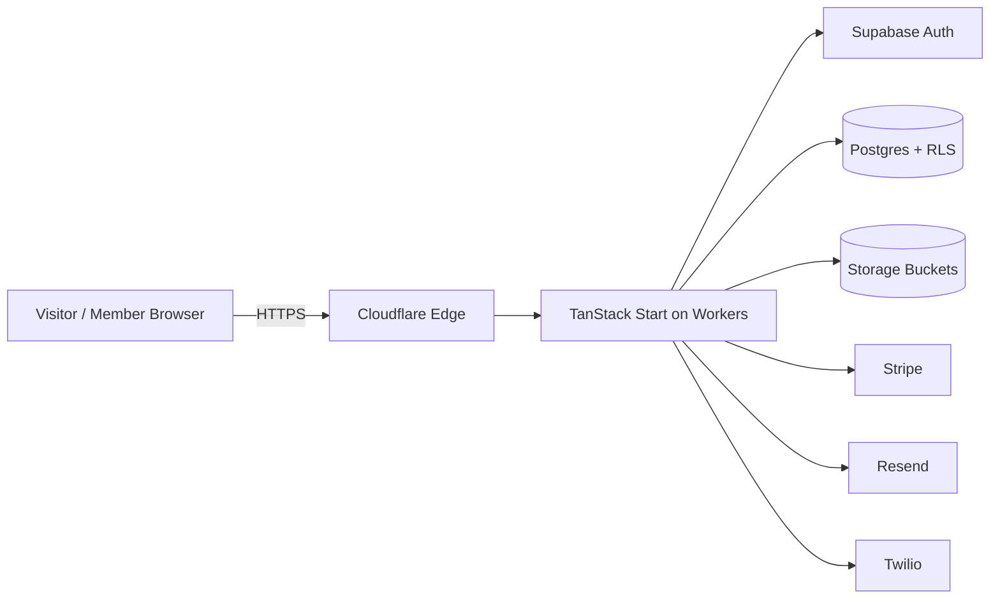

### Application Layers

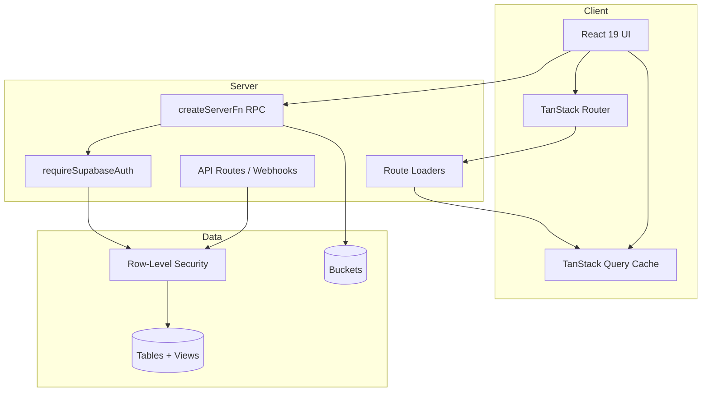

### Data Flow (Read)

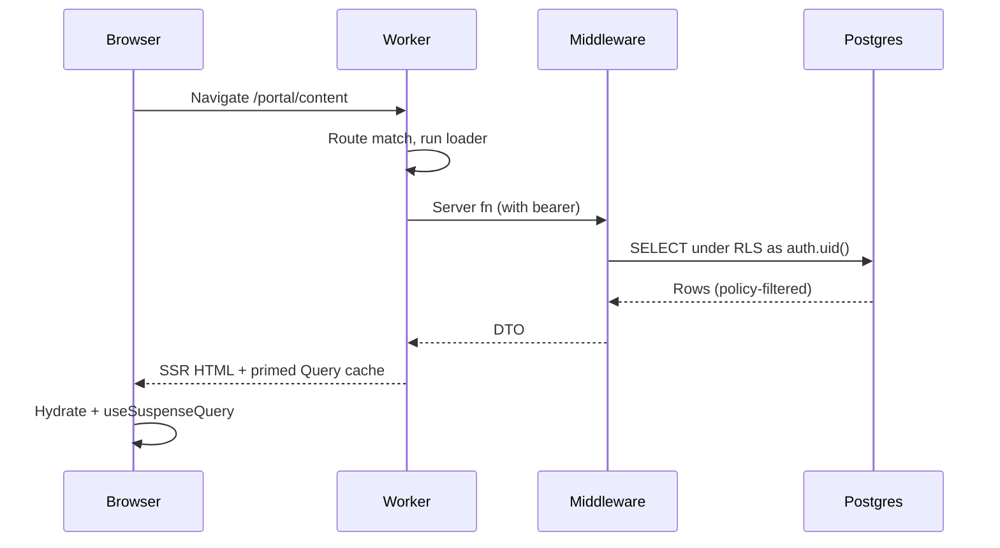

### Authentication Flow

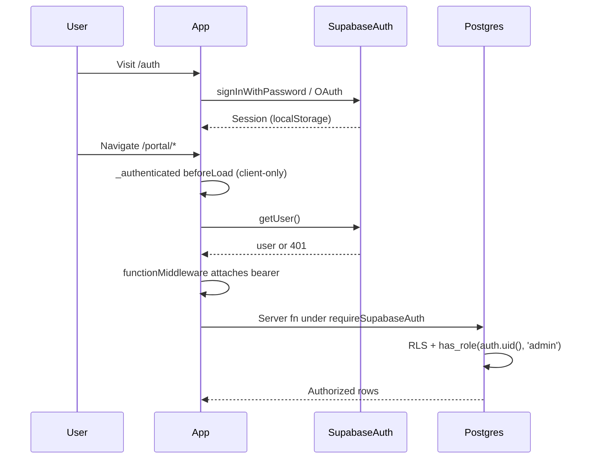

### Member Lifecycle

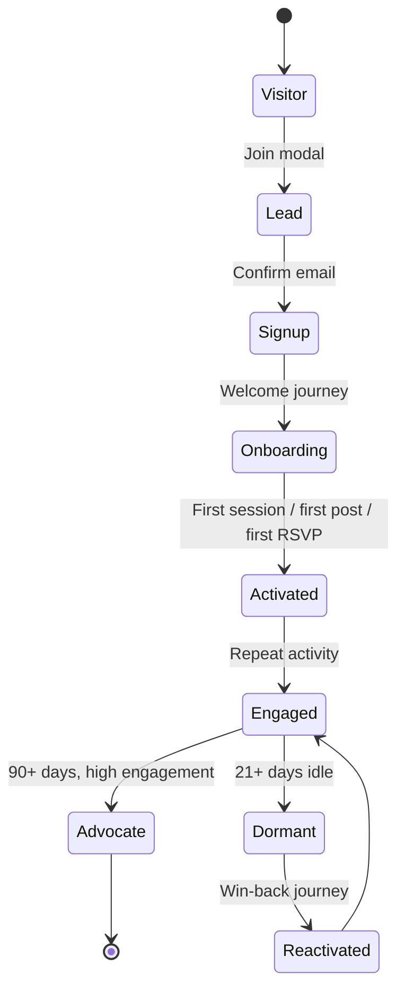

### Content Publishing Flow

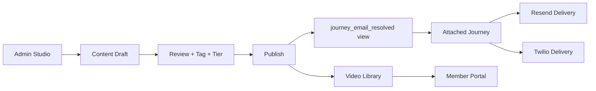

### Commerce Flow

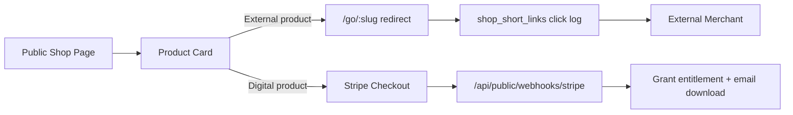

### Automation Flow

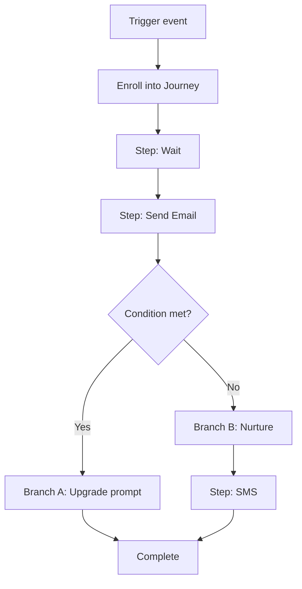

---

## User Journey Diagram

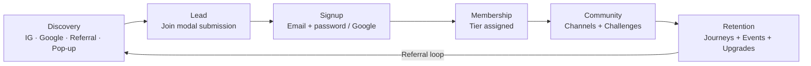

---

## Community Architecture Diagram

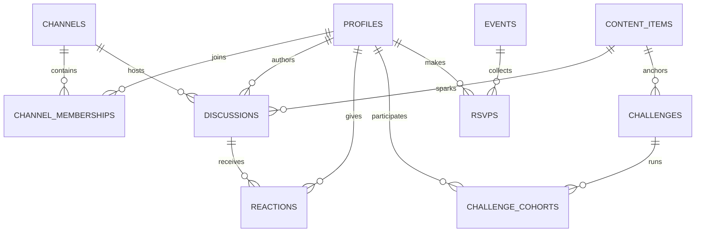

---

## Platform Ecosystem Diagram

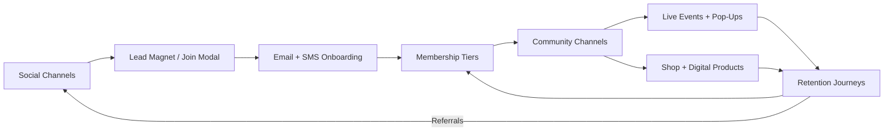

---

## Folder Structure

Annotated tree of the reference implementation.

```text
.
├── db/                            # Raw SQL migrations for app schema
│   ├── admin_roles.sql            # user_roles table + has_role() function
│   ├── journeys_content_link.sql  # journey_email_resolved view
│   ├── shop.sql                   # shop_items + shop_short_links (click tracking)
│   └── ...                        # Additional feature migrations
├── supabase/
│   └── migrations/                # Supabase-managed migrations (Auth, Storage policies)
├── src/
│   ├── routes/                    # File-based routing (TanStack Start)
│   │   ├── __root.tsx             # Root layout, head metadata, providers
│   │   ├── index.tsx              # Public homepage
│   │   ├── shop.tsx               # Public shop
│   │   ├── events.tsx             # Public events listing
│   │   ├── membership.tsx         # Membership tiers landing
│   │   ├── about.tsx              # Brand story
│   │   ├── auth.tsx               # Sign-in / sign-up
│   │   ├── _authenticated/        # Gated subtree (ssr: false)
│   │   │   └── route.tsx          # Auth gate (integration-managed)
│   │   ├── portal.tsx             # Member portal layout
│   │   ├── portal.index.tsx       # Member dashboard
│   │   ├── portal.profile.tsx     # Profile management
│   │   ├── portal.events.tsx      # Member events
│   │   ├── portal.content.tsx     # Protected video library
│   │   ├── admin.tsx              # Admin studio layout
│   │   ├── admin.content.index.tsx    # Content list
│   │   ├── admin.content.$id.tsx      # Content editor
│   │   ├── admin.journeys.$id.tsx     # Journey editor
│   │   └── api/
│   │       └── public/            # Webhooks + short-link redirect
│   │           ├── go.$slug.tsx   # Affiliate short-link tracker
│   │           └── webhooks/      # Signature-verified external callbacks
│   ├── components/
│   │   ├── admin/                 # Admin studio components
│   │   ├── community/             # Channel UI, discussions, reactions
│   │   ├── shop/                  # Product cards, shop grid
│   │   ├── sections/              # Marketing site sections (Hero, Tiers, etc.)
│   │   ├── booking/               # RSVP + waitlist components
│   │   └── ui/                    # shadcn primitives (Button, Card, Dialog, ...)
│   ├── lib/                       # Server functions + shared utilities
│   │   ├── content.functions.ts   # Content read/write RPC
│   │   ├── journeys.functions.ts  # Journey RPC
│   │   ├── shop.functions.ts      # Shop RPC + click tracking
│   │   └── ...
│   ├── integrations/
│   │   └── supabase/
│   │       ├── client.ts          # Browser Supabase client
│   │       ├── client.server.ts   # Service-role admin client (server-only)
│   │       ├── auth-middleware.ts # requireSupabaseAuth
│   │       ├── auth-attacher.ts   # Bearer-token functionMiddleware
│   │       └── types.ts           # Generated DB types
│   ├── config/
│   │   ├── branding.ts            # Brand name, logo, colors, tier labels
│   │   └── integrations.ts        # Feature flags for Stripe / Resend / Twilio
│   ├── styles.css                 # Tailwind v4 @theme + semantic tokens
│   ├── router.tsx                 # Router construction
│   └── start.ts                   # Server bootstrap + functionMiddleware
├── docs/
│   └── screenshots/               # Reference screenshots (see Screenshots section)
├── public/                        # Static assets (favicon, robots.txt, sitemap)
├── wrangler.jsonc                 # Cloudflare Workers config
├── vite.config.ts                 # Vite + TanStack Start plugin
├── package.json
└── README.md                      # This file
```

Every folder has a single responsibility: `routes/` owns URLs and SSR, `lib/` owns server logic, `components/` owns presentation, `integrations/` owns third-party glue, and `config/` owns the values that make this codebase re-brandable.

---

## Accessibility

Accessibility is a first-class product requirement, not a compliance afterthought.

- **Keyboard navigation.** Every interactive element is reachable by Tab and operable by Enter or Space. Focus rings are visible and use semantic tokens.
- **Semantic HTML.** Landmarks (`<header>`, `<nav>`, `<main>`, `<footer>`), a single `<h1>` per page, and correctly nested headings.
- **Color contrast.** All text meets WCAG AA at minimum against its background. The design system's semantic tokens are audited for contrast in both light contexts (foundational to the reference brand).
- **Screen readers.** Icons carry `aria-label` when they are the only affordance. Live regions announce toasts and status updates. Dialogs trap focus and restore it on close.
- **Responsive.** Mobile-first breakpoints. All member-facing surfaces work at 360px width; admin surfaces target 1024px+.
- **Reduced motion.** Animations respect `prefers-reduced-motion`.
- **Inclusive design.** Copy avoids ability assumptions, gendered defaults, and body-shape language. Wellness content specifically avoids weight-loss framing unless a member has opted in.

---

## Performance

- **Edge SSR** via TanStack Start on Cloudflare Workers. First paint is served from the nearest POP.
- **Route-based code splitting** — TanStack's code-splitter emits a chunk per route. Members downloading the portal don't download the admin studio.
- **Loader-primed cache.** Loaders call `context.queryClient.ensureQueryData(...)`; components read with `useSuspenseQuery`. No waterfall between navigation and data.
- **SWR revalidation.** Loader data serves instantly and refreshes in the background.
- **Image strategy.** Poster images ship in modern formats with explicit dimensions to prevent CLS. Lazy loading is the default.
- **Font strategy.** Web fonts loaded via `<link>` in the root head — Tailwind v4 CSS never `@import`s remote URLs (Lightning CSS resolves from disk).
- **Edge caching.** Public routes are served with cache headers that let Cloudflare cache the SSR HTML at the edge.
- **Query deduplication.** TanStack Query dedupes concurrent identical requests across the app.
- **Bundled worker.** All dependencies are bundled at build time — no runtime module resolution in the worker.

---

## Security

Security is enforced at multiple layers, defense-in-depth.

- **Supabase Auth.** Password hashing, session management, and OAuth flows are handled by Supabase, not implemented in-app.
- **Row-Level Security on every user-facing table.** Policies scope every read and write to `auth.uid()`.
- **Separate roles table.** Roles live in `public.user_roles` with an `app_role` enum. **Never** on the `profiles` table. This is the well-known safe pattern that prevents client-side privilege escalation.
- **`has_role()` security-definer function.** RLS policies call `has_role(auth.uid(), 'admin')`. The function runs with owner privileges to avoid recursive RLS on the roles table itself.
- **Explicit GRANTs.** Every `CREATE TABLE public.<name>` migration is followed by `GRANT` statements scoped to `authenticated`, `anon` (only when a public policy exists), and `service_role`. Missing GRANTs are a class of bug the migration workflow rejects.
- **Server-only secrets.** `SUPABASE_SERVICE_ROLE_KEY`, `STRIPE_SECRET_KEY`, `RESEND_API_KEY`, and `TWILIO_AUTH_TOKEN` are read via `process.env.*` **inside** server-function handlers only. They are never exposed to the browser, never read at module scope of client-reachable files, and never logged.
- **Publishable keys only in the browser.** The Supabase anon JWT and public URL are the only Supabase credentials that ship to the client. Access is bounded by RLS.
- **Webhook signature verification.** Every route under `/api/public/webhooks/*` verifies the incoming HMAC signature with `timingSafeEqual` before touching the database.
- **Admin client isolation.** `supabaseAdmin` (service role, RLS-bypassing) is loaded via dynamic `await import()` inside server-function handlers only, and used exclusively for verified webhooks and admin maintenance. It is not the default Data API client.
- **RBAC on privileged server functions.** Every server function that performs privileged work verifies `context.userId` has the required role via `has_role` before proceeding.
- **Bearer-token middleware.** Server-function calls attach the Supabase access token via `functionMiddleware` in `src/start.ts`. Unauthenticated calls to `requireSupabaseAuth`-protected functions return 401.
- **Public route loaders never call protected server functions.** Prerender has no session; a protected call in a public loader would fail the build. Protected calls happen inside the `_authenticated` subtree or from event handlers via `useServerFn`.
- **Env hygiene.** `.env`, `.env.*`, `supabase/.env*`, and `.dev.vars` are all gitignored. `.env.example` ships with placeholder values only.
- **Stripe security posture.** Checkout sessions are created server-side. Webhooks verify Stripe signatures. No card data ever touches the app.
- **Content Security Policy.** Response headers restrict script and image origins to known providers.
- **CSRF.** Server functions are same-origin RPC; the browser's same-origin policy plus the bearer-token requirement provide layered protection.

---

## Scalability

- **Horizontal scale on Cloudflare Workers.** Every request runs on the nearest edge POP. There is no origin server to overload.
- **Stateless worker instances.** No in-memory session state; all durable state is in Postgres.
- **Postgres connection pooling.** Supabase's pooler handles connection reuse; server functions open short-lived connections.
- **Read replicas** (roadmap). For analytics-heavy workloads, read replicas can be introduced without touching application code.
- **Multi-tenant / white-label path.** All brand-specific values (`branding.ts`, `integrations.ts`) are config. A new tenant is a config change plus a new database, not a fork.
- **i18n path.** Copy is centralized enough that a translation layer can be inserted without route restructuring.
- **Multi-community.** The community model (channels, discussions, challenges) already supports multiple concurrent communities keyed by tenant; the public surface simply shows one.
- **Content delivery.** Video hosting is externalized (Vimeo / Mux / YouTube-unlisted) so the platform never streams bytes itself.
- **Search.** Postgres full-text search is used first; migration path to a dedicated search index (Meilisearch, Typesense) is straightforward when catalog size demands it.
- **Analytics warehousing.** First-party events currently live in Postgres. When volume warrants, a nightly export to a warehouse (BigQuery, Snowflake, DuckDB in R2) is a drop-in.

---

## Future Roadmap

### Phase 1 — Foundation (shipped / shipping)

- Public site, member portal, community channels, protected library.
- Membership tiers with founding-phase complimentary access.
- Content Studio, Journeys, Shop with affiliate short links.
- Events with RSVPs and waitlists.
- RBAC via `user_roles` + `has_role()`.
- Edge SSR on Cloudflare Workers.

### Phase 2 — Monetization Turn-On

- Stripe subscriptions live for paid tiers.
- Digital product checkout and instant delivery.
- Referral rewards program.
- Gift memberships.
- Corporate / team plans.
- Coupons, promo codes, and founding-member grandfathering.

### Phase 3 — Intelligence

- Lovable AI Gateway integration.
- Personalized content recommendations.
- Semantic search across the library.
- Class summarization and chapter markers.
- "Ask the founder" AI assistant trained on the founder's content.
- Predictive churn scoring and pre-emptive win-back journeys.

### Phase 4 — Ecosystem and Platform

- Multi-tenant white-label offering (platform-as-a-service).
- Public API for third-party integrations.
- Mobile apps (React Native, shared components).
- Native calendar and Apple Health / Google Fit integration.
- Physical studio operations (check-in, class rosters, coach app).
- Marketplace for guest instructors and collaborators.

---

## Screenshots

Reference imagery for the reference implementation. Files live under `docs/screenshots/` and are referenced only as placeholders in this repository.

| File | Purpose | Feature | Business Value |
|---|---|---|---|
| `docs/screenshots/home-hero.png` | Homepage hero | Public site / brand identity | First-impression conversion |
| `docs/screenshots/about-community.png` | About / community narrative | Brand story | Trust and identity |
| `docs/screenshots/events-landing.png` | Events landing page | Live events | RSVP conversion |
| `docs/screenshots/join-modal.png` | Join community modal | Lead capture | Top-of-funnel conversion |
| `docs/screenshots/membership-tiers.png` | Tiered membership page | Membership monetization | Tier education, upgrade path |
| `docs/screenshots/shop-hero.png` | Shop landing | Commerce | Revenue diversification |
| `docs/screenshots/portal-dashboard.png` | Member portal dashboard | Portal experience | Retention and daily-active engagement |
| `docs/screenshots/portal-content-public.png` | Public video library view | Content discovery | Free-tier engagement |
| `docs/screenshots/portal-content-members.png` | Members-only library | Gated content | Upgrade driver |
| `docs/screenshots/portal-events.png` | Member events view | Live class RSVPs | Habit formation |
| `docs/screenshots/portal-profile.png` | Profile management | Account hygiene | Data quality, deliverability |
| `docs/screenshots/community-channel.png` | Community channel view | Community | Retention and identity |
| `docs/screenshots/community-challenge.png` | Challenge cohort view | Challenges | Retention lever |
| `docs/screenshots/admin-content-list.png` | Admin content list | Content Studio | Operator velocity |
| `docs/screenshots/admin-content-editor.png` | Admin content editor | Content Studio | Publishing UX |
| `docs/screenshots/admin-journey-editor.png` | Admin journey editor | Lifecycle automation | Retention + conversion at scale |
| `docs/screenshots/admin-shop.png` | Admin shop item editor | Commerce ops | Curation velocity |
| `docs/screenshots/admin-users.png` | Admin user + roles view | RBAC | Safe operator delegation |
| `docs/screenshots/analytics-overview.png` | Analytics overview | Instrumentation | Data-driven retention |

---

## Getting Started

A brief, opinionated setup for local development. This is not the focus of the README — the architecture is.

### Prerequisites

- **Bun** (package manager)
- **Node.js 20+** (for Wrangler and tooling)
- **Wrangler** (Cloudflare Workers CLI)
- A **Supabase project** (or Lovable Cloud, which provisions one)
- Optional: **Stripe**, **Resend**, **Twilio** accounts for paid-tier features

### Setup

```bash
# 1. Install dependencies
bun install

# 2. Copy env template and fill in your values
cp .env.example .env

# 3. Apply database migrations in order
#    (against your Supabase project via psql or the Supabase SQL editor)
#    Order:
#    - db/admin_roles.sql        (user_roles + has_role)
#    - db/*.sql                   (feature tables)
#    - db/journeys_content_link.sql (journey_email_resolved view)
#    - db/shop.sql                (shop_items + shop_short_links)

# 4. Bootstrap the first admin user (after signing up in the app once)
#    Run in Supabase SQL editor, replacing the email:
#
#    INSERT INTO public.user_roles (user_id, role)
#    SELECT id, 'admin'::app_role FROM auth.users WHERE email = 'you@brand.com';

# 5. Run the dev server
bun run dev

# 6. Deploy to Cloudflare Workers
bun run deploy
```

### Environment Variables

See `.env.example` for the full list. Server-only secrets (never prefixed with `VITE_`) include `SUPABASE_SERVICE_ROLE_KEY`, `STRIPE_SECRET_KEY`, `STRIPE_WEBHOOK_SECRET`, `RESEND_API_KEY`, `TWILIO_ACCOUNT_SID`, and `TWILIO_AUTH_TOKEN`. Client-visible values are prefixed with `VITE_` and are safe to ship in the browser bundle.

---

## Lessons Learned

Engineering and product reflections from building this platform.

### Engineering

- **Isomorphic loaders are a discipline, not a feature.** TanStack Start loaders run on both server and client. Every loader must be safe to run in either — no `window`, no service-role clients, no server-only secrets.
- **RLS is worth the upfront cost.** Getting policies right early prevents an entire category of authorization bugs later. It also makes the database self-documenting.
- **The `user_roles` separation matters.** Storing roles on the profile row feels convenient for one day and then becomes a security liability forever. The `has_role()` pattern is worth the extra table.
- **Server functions beat REST for internal RPC.** Typed end-to-end, colocated with the code that uses them, no manual schema syncing. REST only re-enters the picture for webhooks and public APIs.
- **The `_authenticated` subtree must be client-only.** Supabase sessions live in `localStorage`, which the server can't read. Server-gating that subtree creates redirect loops on hard refresh. Skip SSR for it and be done.
- **Bundle everything.** Workers don't resolve modules at runtime. Any dependency that assumes Node's filesystem or spawns processes is a runtime failure waiting to happen — audit early.
- **Semantic tokens or bust.** Hardcoding `bg-black` in components ruins themeability forever. Every color goes through `@theme` and `hsl(var(--token))`.
- **Migrations are code.** Every schema change is a `.sql` file in `db/` or `supabase/migrations/`, reviewed like any other code. Manual database edits are a compounding tax.

### Product

- **Community is not a feature — it's the product.** Content is the acquisition wedge. Community is the retention engine.
- **Onboarding is a week, not a modal.** Members who receive four touchpoints in the first seven days retain at meaningfully higher rates than those who receive one.
- **Free founding phase builds an unfair moat.** Paid members who joined free feel loyalty, not price sensitivity, when pricing turns on.
- **Curation is a product.** The shop is not a catalog; it's a personality. Members buy the taste, not the SKU.
- **Events convert digital members into evangelists.** One pop-up outperforms three months of email.
- **Retention journeys pay for the platform.** A single well-designed win-back journey recovers more revenue than most new-feature work.
- **Operators need calm interfaces.** The admin studio is the tool the brand lives in daily — its design deserves the same care as the member surfaces.

---

## Conclusion

The Wellness Membership Platform is what you get when you take the six SaaS tools a modern wellness brand cobbles together, remove the seams, and rebuild them as one product with one identity, one database, one design language, and one deployment target.

It is a **content platform** because content is the acquisition wedge. It is a **community product** because community is the retention engine. It is a **commerce surface** because curation is monetizable identity. It is an **events engine** because IRL converts digital members into evangelists. It is a **lifecycle automation system** because scale requires it to feel personal without being manual.

It is deployed today as B.MARC Pilates. It is designed to be re-deployed tomorrow as any wellness brand that wants to own its members, its data, its content, and its future.

---

## License and Credits

### License

Released under the **MIT License**. See `LICENSE` for full terms.

### Credits

- **Framework:** [TanStack Start](https://tanstack.com/start), [TanStack Router](https://tanstack.com/router), [TanStack Query](https://tanstack.com/query)
- **UI Primitives:** [shadcn/ui](https://ui.shadcn.com/), [Radix UI](https://www.radix-ui.com/)
- **Styling:** [Tailwind CSS v4](https://tailwindcss.com/)
- **Backend:** [Supabase](https://supabase.com/) (Auth, Postgres, Storage)
- **Runtime:** [Cloudflare Workers](https://workers.cloudflare.com/)
- **Build tool:** [Vite](https://vitejs.dev/)
- **Package manager:** [Bun](https://bun.sh/)
- **Validation:** [Zod](https://zod.dev/)
- **Diagrams:** [Mermaid](https://mermaid.js.org/)
- **Payments:** [Stripe](https://stripe.com/)
- **Email:** [Resend](https://resend.com/)
- **SMS:** [Twilio](https://www.twilio.com/)

### Reference Implementation

Deployed as **B.MARC Pilates** — a wellness ecosystem built for movement, connection, and intentional living. The codebase is intentionally generic; the brand is the reference.

### Built With

Product engineering, systems thinking, and an unreasonable belief that the wellness industry deserves better software.

---

<p align="center"><em>More than a studio. A wellness ecosystem.</em></p>
